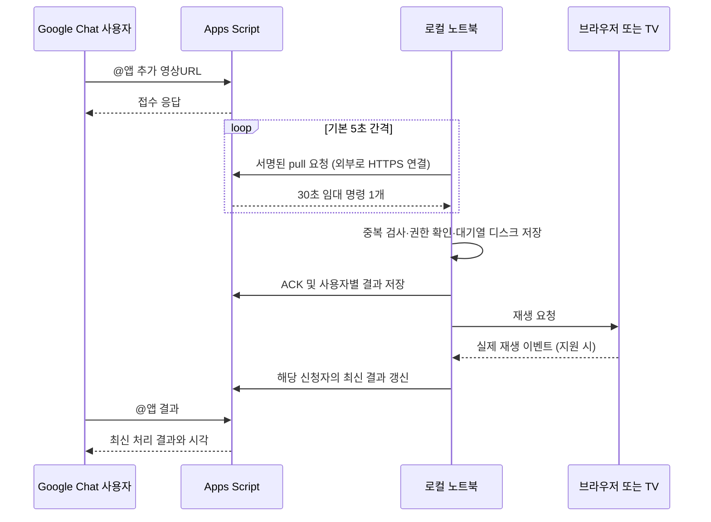

# Apps Script로 Google Chat 연결하기

이 절차는 TV 없이 노트북과 테스트용 Chat 스페이스로 지금 검증할 수 있습니다. 실제 Google 계정 배포는 자동 테스트와 별개이며 아직 수행하지 않았습니다. 기존 Google Workspace 구독 외에 새 유료 서비스·결제 계정을 연결하지 않는 것이 전제입니다.

## 버튼으로 사용하기

연결을 마쳤으면 앱을 멘션만 해서 보내세요. 메뉴 카드의 입력칸에 링크를 넣고 신청하기를 누르면 됩니다. 상태 새로고침·내 신청 결과 확인·재생 제어·곡별 취소는 같은 카드에서 처리합니다. 별도 명령 입력은 선택 사항입니다. 웹 UI는 관리 키 한 번과 이 화면에서 재생 버튼으로 영상까지 연결합니다. 상태 카드 캐시를 쓰려면 변경된 Apps Script 웹 앱 버전도 배포해야 합니다.

## 원리와 비용 경계



Apps Script가 노트북의 사설 IP로 접속하는 방식이 아닙니다. 노트북이 Google로 나가는 연결만 필요합니다. 포트포워딩, 공개 노트북 HTTP 서버, 터널, Cloud Run, Pub/Sub, 서비스 계정, JSON 비밀 키가 필요하지 않습니다. GitHub는 코드와 CI를 맡고 실행은 노트북에서 합니다.

- Cloud 프로젝트에는 **결제 계정을 연결하지 마세요**. 기존 유료 프로젝트 재사용 대신 결제 미연결 전용 프로젝트를 권장합니다. 콘솔의 결제 화면에서 미연결 상태를 직접 확인하세요. 코드가 Cloud 결제 상태를 조회·검증하지는 않습니다.
- 결제 활성화가 강제되면 진행을 멈추세요. 조직 정책을 우회하거나 무료 체험 결제 계정을 추가하지 마세요.
- Apps Script 할당량을 초과하면 작업이 실패/중단됩니다. 유료 인프라로 자동 전환하는 코드는 없습니다. 로컬 관리 화면은 계속 사용할 수 있습니다.
- `google.subscription` / `serviceAccountFile`이 남은 활성 설정은 `COST_POLICY`로 거부합니다. 이전 버전의 Pub/Sub 자원을 이미 만들었다면 별도로 확인해야 하며, 코드 변경이 기존 클라우드 자원을 삭제하지 않습니다.
- 처음에는 YouTube API 키를 비워 두고 URL로 시험하세요. 제목 검색은 나중에 **결제 미연결 프로젝트**에서 YouTube Data API v3와 해당 API로 제한한 키를 설정합니다. 검색 할당량 소진 시 URL 신청을 사용합니다.
- 기존 Workspace 이용료, 노트북 전력·인터넷 비용까지 없어지는 뜻은 아닙니다. 외부 정책 변경이나 조직별 배포 제한은 코드가 보장할 수 없습니다.

## 1. 로컬 설정과 키 생성

Node 24 이상을 준비하고 프로젝트 폴더에서 실행합니다. Python과 npm은 필요 없습니다.

```powershell
node src/main.js init
```

`config.local.json`에 관리자 토큰·재생기 토큰·`google.sharedSecret`이 각각 생성됩니다. 파일은 Git에서 제외됩니다. 공유 비밀은 Google 계정 키가 아니라 이 노트북과 Apps Script 사이의 인증 값입니다. 공개 채팅·스크린샷·GitHub에 넣지 마세요.

이미 설정 파일이 있으면 init은 덮어쓰지 않습니다. 서버를 종료하고 기존 설정을 별도로 보존한 뒤 `google` 객체만 새 예제 구조로 바꾸세요. 공유 비밀이 없으면 다음 명령의 출력을 **로컬에서만** 복사해 넣습니다.

```powershell
node -e "console.log(require('node:crypto').randomBytes(32).toString('base64url'))"
```

관리자·재생기 토큰을 공유 비밀로 재사용하지 마세요.

## 2. 결제 미연결 Google Cloud 프로젝트

1. 테스트할 Workspace 계정으로 [Google Cloud 콘솔](https://console.cloud.google.com/)에 접속합니다.
2. 상단 프로젝트 선택 → 새 프로젝트. 예: `office-jukebox-test`.
3. 해당 프로젝트의 결제 화면에서 결제 계정이 연결되어 있지 않은지 확인합니다. 결제/카드 등록 안내가 나오면 활성화하지 않습니다.
4. API 및 서비스 → 라이브러리 → **Google Chat API** → 사용 설정. Pub/Sub API는 활성화하지 않습니다.
5. Google Auth platform 설정이 필요하면 Branding에서 앱 이름·지원 이메일을 입력하고 Audience는 **Internal**로 설정합니다. 이 버전은 추가 OAuth 범위가 필요 없습니다. Gmail·Drive·Sheets 범위를 추가하지 않습니다.

공식 빠른 시작 문서에는 환경에 따라 billing 활성화가 필요할 수 있다고 안내되어 있습니다. 따라서 이 프로젝트의 추가 비용 0원 조건에서는 그 단계가 필요한 계정/조직 구성이면 중단해야 합니다.

## 3. Apps Script 파일 준비

1. [Apps Script](https://script.google.com/home/start)에서 새 프로젝트를 만듭니다. 이름은 `Office Jukebox Bridge`로 합니다.
2. 편집기의 기본 `Code.gs` 내용을 저장소의 [apps-script/Code.gs](../apps-script/Code.gs) 전체로 교체합니다.
3. 프로젝트 설정(톱니바퀴) → 편집기에 `appsscript.json` 표시를 켭니다.
4. 표시된 파일을 저장소의 [apps-script/appsscript.json](../apps-script/appsscript.json) 내용으로 교체하고 저장합니다. 이 JSON은 배포 메타데이터이며 서비스 계정 비밀 키가 아닙니다. `oauthScopes`는 빈 배열입니다.
5. 프로젝트 설정 → 스크립트 속성에 아래 두 값을 추가합니다.

| 속성 | 값 |
|---|---|
| `SHARED_SECRET` | 로컬 `google.sharedSecret`의 실제 값, 따옴표 없이 |
| `ALLOWED_SPACES` | 처음에는 `[]` |

소스에 실제 키를 붙여 넣지 마세요. 편집기에서 `onMessage`를 실행하면 Chat 이벤트가 없어서 실제 연결 시험이 되지 않습니다.

이 버전은 Chat 기본 이벤트를 사용하므로 Apps Script의 기본 Cloud 프로젝트를 유지해도 됩니다. 별도 표준 Cloud 프로젝트로 연결을 바꾸는 작업은 이 시험에 필요하지 않습니다.

## 4. Chat 앱 등록 (일반 Chat 앱 모드)

1. Apps Script 우측 상단 **배포 → 배포 테스트**에서 **Head deployment ID**를 복사합니다. 이후 코드 저장 사항이 Chat 시험 배포에 반영됩니다.
2. 앞에서 선택한 Cloud 프로젝트 → Google Chat API → **구성(Configuration)**으로 이동합니다.
3. **Build this Chat app as a Google Workspace add-on**이 켜져 있으면 끕니다. 이 저장소는 일반 Chat 앱의 `onMessage` 응답을 사용합니다. add-on 모드의 별도 응답 래퍼와 혼동하지 마세요.
4. 앱 이름 `Office Jukebox`, 설명, 아바타 URL을 입력합니다. 예시 아바타: `https://developers.google.com/workspace/chat/images/quickstart-app-avatar.png`.
5. Functionality에서 스페이스 및 그룹 대화 참여를 켭니다. 메시지를 받을 수 있는 상태로 둡니다.
6. Connection settings는 **Apps Script**를 선택하고, 1번의 **Head deployment ID**를 붙여 넣습니다. URL을 넣는 칸이 아닙니다.
7. Visibility는 도메인의 특정 사용자/그룹으로 제한하고 본인의 Workspace 이메일만 먼저 추가합니다. 저장합니다.
8. Google Chat에서 테스트 스페이스를 만들고 스페이스의 앱 추가/관리 메뉴에서 `Office Jukebox`를 찾아 추가합니다. 검색되지 않으면 Visibility의 계정과 조직의 Chat 앱 사용 정책을 확인합니다.
9. 스페이스에서 앱을 멘션하고 `내정보`를 보냅니다. 예: `@Office Jukebox 내정보`.
10. 앱이 답한 `spaces/...`와 `users/...` 값을 로컬에 기록합니다. 표시 이름이나 이메일을 대신 넣지 않습니다.

여기까지 되면 **Chat → Apps Script의 실제 연결**은 확인한 것입니다. 아직 노트북으로 요청이 전달된 것은 아닙니다. `내정보`는 ID 조회만 하며 대기열을 바꾸지 않습니다.

## 선택: 짧은 명령 등록

Chat API 구성 → 명령어 추가에서 1~1000 사이의 서로 다른 ID를 정하고 유형을 **슬래시 명령어**로 선택합니다. 대화상자 옵션은 끕니다. 한글 또는 영문 이름으로 다음 명령을 등록할 수 있습니다.

| 한글 | 영문 | 인수 |
|---|---|---|
| `/추가` | `/add` | URL 또는 곡명 |
| `/검색` | `/search` | 곡명 또는 URL |
| `/선택` | `/select` | 검색 후보 번호 |
| `/취소` | `/cancel` | 대기곡 번호 |
| `/대기열` | `/queue` | 없음 |
| `/상태` | `/status` | 없음 |
| `/결과` | `/result` | 없음 |
| `/내정보` | `/info` | 없음 |
| `/일시정지` | `/pause` | 없음, 운영자 전용 |
| `/계속` | `/resume` | 없음, 운영자 전용 |
| `/다음` | `/next` | 없음, 운영자 전용 |
| `/정지` | `/stop` | 없음, 운영자 전용 |
| `/재시도` | `/retry` | 없음, 운영자 전용 |
| `/도움말` | `/help` | 없음 |

자동완성에서 명령을 선택한 후 인수를 붙여 전송하세요. 일반 텍스트로 전송하면 앱으로 전달되지 않을 수 있습니다. 명령 저장과 실제 Chat 자동완성 반영은 별도이므로 등록만으로 실행 성공을 판정하지 마세요. 자동완성에 보이지 않으면 기존 앱 멘션 방식으로 동일한 명령을 사용할 수 있습니다. 코드 변경 후 Chat의 Head 배포에는 저장된 코드가 반영되며, 웹 앱의 변경된 `doPost`를 사용할 때는 웹 앱 버전도 갱신해야 합니다.

## 5. 스페이스 허용과 노트북용 웹 앱 배포

1. Apps Script의 스크립트 속성 `ALLOWED_SPACES`를 `["spaces/방금확인한ID"]`로 바꿉니다. JSON 배열이므로 큰따옴표·대괄호를 유지합니다.
2. Apps Script에서 **배포 → 새 배포 → 유형 선택 → 웹 앱**.
3. 실행 주체는 **나(소유자)**, 접근 권한은 **모든 사용자/Anyone**로 선택합니다. 로그인 불필요한 유형이어야 로컬 Node가 계정 쿠키 없이 접근할 수 있습니다.
4. 조직에서 해당 접근 유형을 제공하지 않거나 금지했다면 이 방식의 연결은 여기서 막힙니다. 정책을 낮추거나 로그인 쿠키를 추출해서 우회하지 마세요. 로컬 UI/HDMI 시험은 별도로 계속할 수 있습니다.
5. 웹 앱을 배포하고 `https://script.google.com/macros/s/.../exec` URL을 복사합니다. `/dev` 테스트 URL은 사용하지 않습니다.

웹 주소는 인터넷에서 호출할 수 있지만, 모든 중계 작업에 공유 비밀로 만든 HMAC 서명·시각·nonce가 필요합니다. `doPost`에는 명령 생성 기능이 없으며, 명령 생성은 Google Chat의 `onMessage` 경로만 사용합니다. 메일·파일·브라우저 계정에 접근하는 OAuth 범위는 없습니다. 공개 엔드포인트이므로 악의적 호출에 의한 실행 할당량 소진까지 막아 주는 서비스는 아닙니다.

두 배포 값을 구분하세요.

| 값 | 넣는 곳 |
|---|---|
| Head deployment ID | Google Chat API → 구성 → Apps Script |
| 웹 앱 `/exec` URL | 노트북 `config.local.json` → `google.scriptUrl` |

## 6. 로컬 서버에 연결

`config.local.json`에서 `google` 객체를 다음 형태로 설정합니다. 실제 공유 비밀은 1번에서 생성된 값을 유지합니다.

```json
{
  "enabled": true,
  "transport": "apps-script",
  "scriptUrl": "https://script.google.com/macros/s/YOUR_DEPLOYMENT/exec",
  "sharedSecret": "YOUR_SEPARATE_RANDOM_SECRET_AT_LEAST_32_CHARS",
  "pollIntervalMs": 5000,
  "allowedSpaces": ["spaces/YOUR_SPACE"],
  "operatorUsers": ["users/YOUR_USER_ID"]
}
```

위 객체는 전체 설정의 `google` 필드 값입니다. `youtubeApiKey`는 우선 빈 문자열로, `adapter`는 `{ "type": "browser" }`로 둡니다. 기존 `subscription`과 `serviceAccountFile` 필드는 제거합니다.

```powershell
node src/main.js check-google
```

`ok: true`, `transport: apps-script`를 확인합니다. 이 검사는 서명된 check 요청으로 배포 접근·공유 비밀·허용 스페이스를 확인하며 노래를 추가하지 않습니다. nonce를 임시 캐시에 기록합니다. `billingVerified: false`, `hardwareVerified: false`는 정상이며, 결제 상태와 실제 화면 재생은 별도 확인한다는 뜻입니다.

```powershell
node src/main.js
```

서버 창을 계속 열어 두세요. 서버는 기본 5초마다 한 명령을 가져옵니다. 다른 노트북에서 같은 Apps Script를 동시에 실행하지 마세요. 재시작 직후 기존 worker 임대가 남으면 최대 45초 기다립니다.

## 7. 지금 실제 Chat → 노트북 → 재생 시험

1. 노트북 브라우저에서 `http://127.0.0.1:8787`을 열고 `adminToken`으로 연결합니다.
2. 다른 탭에서 `http://127.0.0.1:8787/player`를 열고 `playerToken`으로 연결합니다. 자동재생 차단 시 화면의 재생 허용 버튼을 누릅니다.
3. Chat 테스트 스페이스에서 `@Office Jukebox 추가 https://www.youtube.com/watch?v=선택한영상ID`를 보냅니다. 실제 11자리 영상 ID의 정상 URL을 사용합니다.
4. **접수했습니다** 응답을 확인합니다. 기본 5~10초 정도 기다리되, 혼잡·네트워크 지연 때 더 걸릴 수 있습니다.
5. `@Office Jukebox 결과`를 보냅니다. 신청 추가/실제 재생/오류에 대한 **본인의 최신 결과**와 처리 시각을 확인합니다. 이전 결과가 보이면 시각을 확인하고 다시 조회합니다.
6. 관리 화면의 곡이 정확히 한 번 추가됐는지, 재생 탭에서 해당 영상과 소리가 나오는지 확인합니다.
7. `@Office Jukebox 상태` → 잠시 후 `@Office Jukebox 결과`로 노트북이 처리한 상태 응답을 확인합니다. `대기열`도 같은 방식입니다.
8. 운영자 계정으로 `일시정지` → `계속` → `정지`를 보내고, 각각 결과 조회와 실제 화면을 확인합니다. 다른 계정이 테스트 사용자로 허용되어 있다면 그 계정의 정지가 권한 거부되는지도 확인합니다.
9. 서버를 종료하고 새 명령을 보내면 접수는 되지만 처리되지 않습니다. 5분 넘게 지난 명령은 나중에 서버를 켜도 재생되지 않아야 합니다. 최신 결과가 계속 남아 있으므로 처리 시각을 확인하세요.

이 구현은 Apps Script에서 메시지를 자발적으로 푸시하지 않습니다. 따라서 검색 후보·처리 결과·재생 오류는 **결과**로 조회합니다. 결과는 사용자+스페이스별 최신 1건이며 24시간 보관, 최대 50명입니다. 스페이스에 표시된 결과 응답 자체는 같은 스페이스의 참여자가 볼 수 있습니다. 개인 DM 비밀 응답 기능은 아닙니다.

## 8. 곡명 검색을 나중에 추가

URL 경로가 성공한 다음 진행합니다. 결제 미연결 프로젝트에서 YouTube Data API v3를 활성화하고 키를 해당 API로만 제한한 뒤 로컬 `youtubeApiKey`에 저장합니다. 추가 결제 설정이 요구되면 진행하지 않습니다.

`@Office Jukebox 검색 곡명` → 잠시 후 `@Office Jukebox 결과` → 후보 확인 → `@Office Jukebox 선택 1` → 다시 결과 확인. 검색 후보는 동일 사용자·스페이스에서 5분 동안 유효합니다. 할당량을 넘으면 오류로 멈추며 유료 검색으로 전환하지 않습니다.

## 9. 변경·중단·문제 해결

| 현상 | 확인 |
|---|---|
| 앱 검색 안 됨 | Chat API 프로젝트, Visibility 이메일, Workspace 관리자 정책 |
| 내정보도 무응답 | 일반 Chat 앱 모드, Head ID, 코드 저장, Apps Script의 실행 내역 |
| 허용되지 않은 스페이스 | `ALLOWED_SPACES` JSON과 실제 `spaces/...` 일치 |
| BRIDGE_HTTP/FORMAT | 웹 앱 Anyone 접근, `/exec` URL, 배포 버전, 조직 정책, 할당량 |
| BRIDGE_REJECTED | 공유 비밀 일치, 양쪽 시계, 중복 worker; 재시작 후 최대 45초 대기 |
| 결과가 오래됨 | 결과에 표시된 시각, 노트북 실행/인터넷, 관리 화면의 연동 상태 |
| API 키 필요 | URL로 시험하거나 결제 미연결 YouTube API 설정 |
| 접수되지만 화면 안 나옴 | `/player` 토큰·자동재생 허용, 실제 영상 제한, 관리 화면 오류 |
| 할당량 초과 | 재시도 폭주 금지; 사용 시간만 실행하거나 pollIntervalMs를 15000~60000으로 늘림 |

Apps Script 소스를 변경하면 **웹 앱 배포 관리 → 수정 → 새 버전 → 배포**도 수행합니다. Head 기반 Chat 시험 배포와 웹 앱 버전은 다르게 갱신될 수 있습니다. 스크립트 속성 변경은 코드 버전을 새로 배포하지 않아도 적용됩니다.

중단하려면 노트북 서버를 종료하고 `google.enabled`를 false로 바꿉니다. 웹 앱 배포를 보관/중지하고 Chat에서 앱을 제거하면 신규 수신을 막을 수 있습니다. 공유 비밀 유출 시 양쪽에서 새 값을 설정하고 서버를 재시작합니다. 키·실제 ID·주소는 이슈나 CI 로그에 붙이지 마세요.

## 한도와 검증 범위

- ScriptProperties: 큐 최대 50개, 5분 TTL. ACK 전 30초 임대; 처리 후 디스크 기록에 따라 재수신 중복 억제. 최근 Google 메시지 100개 접수 기록, 로컬 처리 기록 최대 5,000개.
- 결과 최대 1,500자, 사용자별 최신 결과 24시간/50명; 결과 전달 영수증 최근 100개/24시간. 무한 보관·전달 보장은 아닙니다.
- Apps Script 속성 변경 여러 건은 DB 트랜잭션이 아닙니다. 실행 강제 중단·저장 할당량 오류 시 중계 저장 사이의 부분 변경 가능성이 있습니다. 로컬 영속 처리 기록이 재생 중복을 줄이지만 분산 시스템 전체의 정확히 한 번 처리를 보장하지 않습니다.
- CacheService의 nonce는 최선 노력 재전송 방지이며 캐시 축출 가능성이 있습니다. HMAC·시간창 검증 및 별도 명령/결과 ID 중복 억제와 함께 사용합니다.
- 모든 Google 계정·조직 정책에서 배포 가능하다는 보장은 없습니다. Apps Script VM 모의 테스트와 HTTP 테스트는 실제 Chat 등록 성공을 대신하지 않습니다.

공식 근거: [일반 Chat Apps Script 앱 설정](https://developers.google.com/workspace/chat/quickstart/apps-script-app#apps-script), [웹 앱 배포](https://developers.google.com/apps-script/guides/web), [Apps Script 할당량과 초과 시 중단](https://developers.google.com/apps-script/guides/services/quotas).
